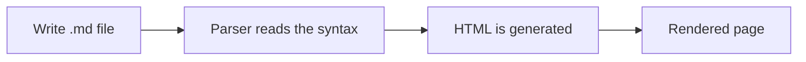

# A Practical Guide to Markdown Syntax

**Author:** Bhupal Thapa 
**Course:** PowerShell Scripting, Lab 4  
**Subject:** Markdown syntax and features

---

## Abstract

Markdown is a lightweight markup language that lets a person write formatted documents in plain text. A Markdown file (`.md`) is converted by a parser into HTML, which is why the same source can render as a clean web page on GitHub, in a documentation site, or in an editor's preview pane. Because the source is plain text, it also works well with version control: every change shows up as a readable line-by-line difference in Git.

This document is both a reference and a demonstration. Each section explains one group of syntax and then uses it, so the file itself is a working example of everything it describes.

---

## Table of Contents

1. [Background](#1-background)
2. [Headings](#2-headings)
3. [Emphasis and inline formatting](#3-emphasis-and-inline-formatting)
4. [Lists](#4-lists)
5. [Links](#5-links)
6. [Images](#6-images)
7. [Blockquotes](#7-blockquotes)
8. [Code](#8-code)
9. [Tables](#9-tables)
10. [Horizontal rules, line breaks and escaping](#10-horizontal-rules-line-breaks-and-escaping)
11. [Additional features](#11-additional-features)
12. [Conclusion](#12-conclusion)

---

## 1. Background

Markdown was created by John Gruber in 2004, with contributions from Aaron Swartz, to be readable as plain text even before it is rendered.[^1] Over time, different tools implemented the rules slightly differently, so the **CommonMark** specification was later published to standardize the core behavior. GitHub uses its own superset called **GitHub Flavored Markdown (GFM)**, which adds tables, task lists, strikethrough, and automatic links.

The syntax in this guide follows GFM. Most of it works in other renderers as well, but a few items, such as task lists and alert boxes, are specific to GitHub.

---

## 2. Headings

A heading begins with one to six `#` characters followed by a space. The number of `#` characters sets the level, similar to the `<h1>` through `<h6>` tags in HTML.

# Heading level 1
## Heading level 2
### Heading level 3
#### Heading level 4
##### Heading level 5
###### Heading level 6

A blank line should be left before and after a heading. Some renderers do not recognize a heading that is attached directly to the paragraph above it.

---

## 3. Emphasis and inline formatting

| Syntax                   | Result                   |
| :----------------------- | :----------------------- |
| `**bold**`               | **bold**                 |
| `*italic*`               | *italic*                 |
| `***bold and italic***`  | ***bold and italic***    |
| `~~strikethrough~~`      | ~~strikethrough~~        |
| `` `inline code` ``      | `inline code`            |

These can be combined with ordinary sentences. For example, the principle of **least privilege** states that an account should have *only* the permissions it needs, and nothing more. A password that is short and reused is ~~acceptable~~ a liability. Commands such as `whoami` and `Get-Process` are written in inline code so they stand out from the surrounding text.

---

## 4. Lists

### 4.1 Unordered lists

Unordered lists use `-`, `*`, or `+`. Indenting an item creates a nested list.

- Reconnaissance
  - Passive information gathering
  - Active scanning
    - Port and service enumeration (performed only on systems I own)
- Analysis
- Reporting

### 4.2 Ordered lists

Ordered lists use numbers followed by a period. The renderer numbers them automatically.

1. Create a virtual machine
2. Take a snapshot
3. Make a configuration change
4. Test the result
5. Document the outcome

### 4.3 Task lists

Task lists use `- [ ]` for an open item and `- [x]` for a completed one.

- [x] Learn headings and emphasis
- [x] Learn lists and links
- [x] Learn code blocks and tables
- [ ] Preview the finished file in a renderer

---

## 5. Links

Markdown supports several kinds of links:

- **Inline link:** [The Markdown Guide](https://www.markdownguide.org/)
- **Inline link with a title:** [GitHub Docs](https://docs.github.com "GitHub documentation")
- **Automatic link:** <https://github.com>
- **Reference-style link:** the [PowerShell Gallery][psgallery] link is defined once at the end of the file and can be reused.
- **Internal link:** return to the [Headings](#2-headings) section.

[psgallery]: https://www.powershellgallery.com/

Reference-style links keep long URLs out of the middle of a paragraph, which makes the raw file easier to read.

---

## 6. Images

The image syntax is the same as the link syntax with an exclamation mark at the front:

```markdown

```

The alt text is displayed if the image cannot be loaded, and it is also read aloud by screen readers, so it should describe the image. The path can be a file in the repository (for example `images/diagram.png`) or a full URL. No image is embedded in this document, so that it can be uploaded as a single file.

---

## 7. Blockquotes

A blockquote begins each line with `>`.

> A system is only as secure as its weakest component.
> Blockquotes are useful for citations, definitions, and callouts.

Blockquotes can be nested by adding more `>` characters:

> Outer quote.
>
> > Inner quote, indented one level further.

GitHub also supports alert blocks, which are blockquotes with a keyword on the first line:

> [!NOTE]
> Notes highlight information that a reader should not overlook.

> [!WARNING]
> Security testing must only be performed on systems that I own or have written permission to test.

---

## 8. Code

### 8.1 Inline code

Inline code uses single backticks, as in `Install-Module -Name ImportExcel`.

### 8.2 Fenced code blocks

A fenced code block uses three backticks before and after the code. Naming the language after the opening fence enables syntax highlighting.

```powershell
# Install the ImportExcel module and read a spreadsheet
Install-Module -Name ImportExcel
Import-Excel "C:\Users\Administrator\Documents\Fruits.xlsx"
```

```bash
# Enumerate open ports and service versions on a lab host
nmap -sV 192.168.56.10
```

```python
# Number of possible 8-character passwords using a-z, A-Z and 0-9
charset_size = 26 + 26 + 10
length = 8
print(charset_size ** length)
```

The `diff` language marks removed lines in red and added lines in green, which is helpful for showing configuration changes:

```diff
- PasswordAuthentication yes
+ PasswordAuthentication no
+ PubkeyAuthentication yes
```

---

## 9. Tables

Tables use pipes (`|`) to separate columns and a row of hyphens to separate the header from the body.

### 9.1 Security terminology

| Term             | Definition                                      | Example                         |
| ---------------- | ----------------------------------------------- | ------------------------------- |
| Least privilege  | Grant only the access that is required          | Standard users are not admins   |
| MFA              | Authentication using two or more factors        | Password plus an app code       |
| Zero Trust       | Verify every request; never assume trust        | Re-check identity on each access|
| Hashing          | One-way transformation of data into a digest    | SHA-256 of a file               |

### 9.2 Column alignment

Colons in the separator row control alignment.

| Left-aligned | Centered | Right-aligned |
| :----------- | :------: | ------------: |
| 22           |   SSH    |           TCP |
| 80           |   HTTP   |           TCP |
| 443          |  HTTPS   |           TCP |

---

## 10. Horizontal rules, line breaks and escaping

**Horizontal rules** are created with three or more hyphens, asterisks, or underscores on their own line. The hyphen form has separated the sections of this document. The other two forms are shown below:

***

___

**Line breaks.** A single newline inside a paragraph is ignored by most renderers. To force a break, end the line with two spaces or a backslash.  
This sentence starts on a new line.

**Escaping.** A backslash prevents a character from being interpreted as formatting. For example, \*this text is not italic\*, and \# this line is not a heading.

---

## 11. Additional features

### 11.1 Footnotes

Footnotes keep supporting detail out of the main text.[^2]

### 11.2 Inline HTML

Markdown allows some HTML where the syntax has no equivalent.

- Keyboard keys: press <kbd>Ctrl</kbd> + <kbd>Shift</kbd> + <kbd>V</kbd> to open the Markdown preview in VSCodium.
- Subscript and superscript: H<sub>2</sub>O and 2<sup>10</sup> = 1024.

### 11.3 Collapsible sections

<details>
<summary>Expand for additional detail</summary>

Content inside a `<details>` block is hidden until the reader expands it. This is useful for long output that would otherwise interrupt the flow of a document.

</details>

### 11.4 Math

GitHub renders LaTeX-style math between dollar signs. The entropy of a randomly generated password is $H = L \log_2 N$, where $L$ is its length and $N$ is the size of the character set.

### 11.5 Diagrams

GitHub renders Mermaid diagrams written in a `mermaid` code block.



### 11.6 Comments

An HTML comment is not displayed in the rendered output but remains in the source file. <!-- This comment is only visible in the raw file. -->

---

## 12. Conclusion

Markdown is simple enough to learn in an afternoon, and it remains useful well beyond it: README files, documentation, lab notes, and reports are commonly written in it. Its plain-text nature means files stay small, work in any editor, and produce meaningful differences under version control. For security work in particular, clear documentation of what was done and why is as important as the technical work itself.

---

[^1]: Gruber's original description is published on his site, Daring Fireball.
[^2]: A footnote can contain a sentence or a short paragraph. GitHub places it at the bottom of the rendered page and links back to the reference.
